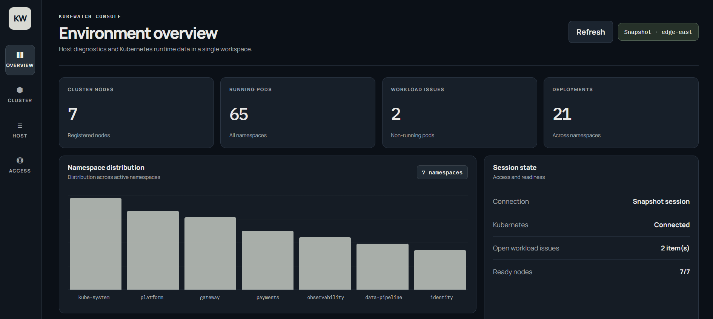
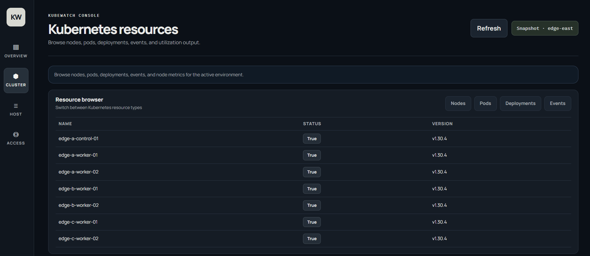
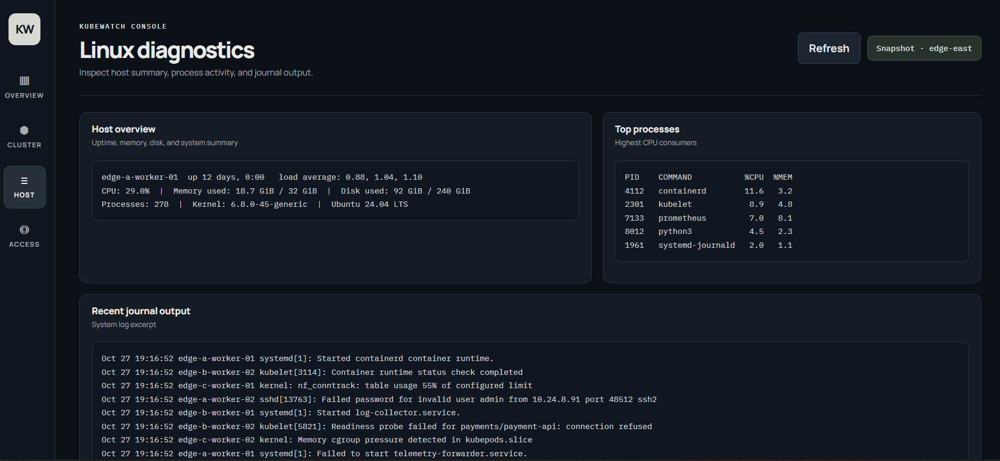
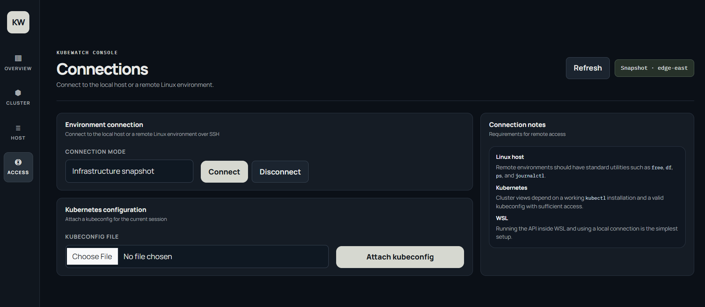
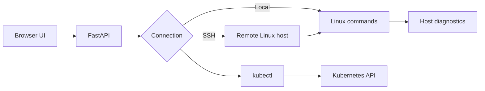

# KubeWatch

**Linux diagnostics and Kubernetes resource inspection, in one console.**

   

KubeWatch provides a browser-based view of Linux host activity, system logs and Kubernetes workloads. It can inspect the machine running the API or connect to another Linux environment through SSH. Kubernetes access uses a kubeconfig attached to the active session.

### Environment overview
The overview brings cluster health indicators and namespace distribution into one dashboard.


### Kubernetes resources
Browse nodes, pods, deployments, events, and utilization output.


### Linux diagnostics
Inspect host summary, process activity, and journal output.


### Connections
Connect to a local or remote Linux environment and attach a Kubernetes kubeconfig.


## What it does

| Area | Available views |
| --- | --- |
| Linux | Uptime, memory, disk, active processes and journal output |
| Log analysis | Pattern matches for authentication, service, resource and network failures |
| Kubernetes | Nodes, pods, deployments, events and resource usage when metrics are available |
| Connections | Local execution, SSH sessions and kubeconfig upload |

The interface queries the current environment rather than using sample measurements. If an environment or service is unavailable, the related panel reports the error.

## Technology

- **Python / FastAPI:** HTTP endpoints and session handling
- **Paramiko:** SSH transport and host-key verification
- **Bootstrap / JavaScript:** browser interface and resource tables
- **Linux utilities:** `free`, `df`, `ps`, `journalctl`, `uptime`
- **Kubernetes CLI:** `kubectl get`, `kubectl top`

## Architecture



The API accepts a fixed list of diagnostic operations. It does not expose unrestricted shell execution.

## Install and run

### Requirements

- Python 3.10 or newer
- Linux or WSL for local system diagnostics
- `kubectl` on the selected environment for Kubernetes inspection
- OpenSSH access for remote environments

```bash
python3 -m venv .venv
source .venv/bin/activate
pip install -r requirements.txt
python -m uvicorn app.main:app --host 127.0.0.1 --port 8000
```

Open `http://127.0.0.1:8000`.

On Windows, running the API inside WSL and selecting **Local machine** is the most direct option.

### Local Linux

1. Open **Access** and select **Local machine**.
2. Select **Connect**.
3. Browse host output from **Overview** and **Host**.

### Remote Linux over SSH

1. Make sure an SSH server is running on the target host.
2. From the API host, verify access to the target machine and add its host key to `~/.ssh/known_hosts`.
3. Open **Access**, select **SSH**, and enter the host, port, username and password.
4. Select **Connect**.

### Kubernetes

1. Connect to an environment where `kubectl` is installed.
2. In **Access**, upload a kubeconfig for a cluster you are authorized to inspect.
3. Use **Cluster** to switch between nodes, pods, deployments and events.
4. Node utilization appears when Metrics Server and sufficient permissions are available.

> A kubeconfig may contain sensitive credentials. Use an appropriately restricted cluster account, and do not commit kubeconfig or private keys to Git.

## Tests

```bash
python -m pytest -q
```

The test suite covers command parsing, operation handling and API behavior. SSH and live Kubernetes connectivity should also be verified in the target environment.

## Repository structure

```text
app/
  engine.py         # Session transport and command execution
  main.py           # FastAPI routes
static/
  index.html        # Interface and design system
  app.js            # Client-side state and rendering
tests/
  test_api.py
  test_engine.py
docs/
  console.png       # UI preview
```

## Operating boundaries

KubeWatch runs as a localhost application, with in-memory sessions and fixed diagnostic operations. The implementation does not include multi-user access control, historical metric storage, alert delivery or TLS termination. It is not designed to be exposed as a public web service.

SSH passwords are used to open sessions and are not persisted in the browser. Kubeconfig content is temporarily staged on the selected machine; normal disconnect closes the session and removes its temporary file. If the process terminates unexpectedly, check for temporary files on the target environment.


